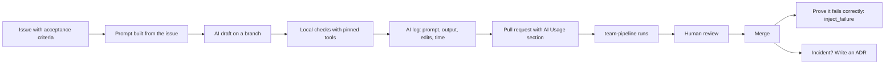

# AI-assisted coding workflow

How our team used AI to build the CI/CD pipeline for this Home Assistant Core
fork, from Sep 28 to Nov 18, 2026. Every claim links to, or comes from, the
repo's commits, pull requests, Actions runs and
[AI logs](ai-log/).

## Summary

We used AI from four products (GitHub Copilot, Claude, Codex and GitHub
Models), and AI wrote the first draft of nearly every pipeline change. Each change went through the same loop:

1. One issue with acceptance criteria.
2. A prompt built from that issue.
3. An AI draft on a branch.
4. Local checks with the project's pinned tool versions.
5. An AI-log entry.
6. A pull request that runs our pipeline.
7. Human review.

In the three merged logs that record time, AI cut the work from 9 hours to
3¼. But every tool got something wrong at least once, and each time the error
was caught by a check, a real run or a person, never by the AI that made it.
Inside the pipeline itself, AI is advisory only and isn't yet running on
`main`.

## Tools and what each did

| Tool | Used for | Issues | Outcome |
|---|---|---|---|
| GitHub Copilot | First pipeline attempt: templates for GitHub Actions, GitLab and Azure (Sep 28) | none | Failed and was replaced |
| Claude Code (Claude Opus 5.5, VS Code) | Mapped the existing pipeline; wrote the plan, 29 issue drafts, the orchestrator and stage stubs, the checklist and the docs; ran and documented L2; fixed the Gitleaks scan range; wrote ADR 0001 | L0, L2, L6, C1 follow-up | Merged in PRs #34, #35, #36 |
| Codex (GPT-6) | Gitleaks secret scanning; pip-audit dependency scanning | C1, C2 | C1 merged (#31). C2's code was lost in a merge (#33). |
| GitHub Copilot Chat | Change detection; the test stage | A1, B1–B5 | A1's code is in open PR #39. B1–B5 are on an unmerged branch. |
| Claude (Opus 5.5, desktop app) | Docker build, pushing to GHCR, cosign signing | D1, D2 | Merged in PRs #37 and #38 |
| GitHub Models (gpt-4o-mini) | AI *inside* the pipeline: the B5 test-gap advisor | B5 | Written but never run |

Upstream's own AI workflow, a GitHub Models language checker, was also on the
fork until PR #30 removed it. It failed 27 out of 27 times, because the model
answered "OK" instead of JSON.

## The workflow

1. **Plan before writing.** Claude Code ran read-only first. It read all 13
   upstream workflows and the failed runs, then asked us three decisions
   before writing any code: which AI service, where to deploy, and who owns
   the orchestrator. People made those decisions.
2. **One issue, one prompt.** Each [issue](issues/) has tasks, acceptance
   criteria and a definition of done. We pasted the issue into the prompt and
   judged the output against those criteria.
3. **Work on a branch.** AI never pushes to `main`, and `main` only takes pull
   requests.
4. **Check with the project's pinned tool versions.** Run zizmor 1.30.1
   `--pedantic`, actionlint, yamllint and prettier 3.6.2 before asking for
   review.
5. **Log it.** `docs/pipeline/ai-log/<issue>.md` records the exact prompt,
   the raw output, what we changed and why, any new dependencies, and the
   time spent.
6. **Open a PR** with the template's AI Usage section filled in. Our pipeline
   runs on it, and a staging deploy needs a person to approve it.
7. **Prove it fails correctly.** `inject_failure` forces one stage to fail.
   All four modes failed the right stage
   ([failure-injection.md](failure-injection.md)).
8. **Write down incidents.** When something breaks, an
   [ADR](adr/README.md) records what happened, the options we weighed and what
   we chose.

## Results

- **Time:** the A1, C1 and C2 logs estimate 9 hours of work without AI and
  report 3 h 15 min with AI, including review and fixes. That's 64% less. The
  unmerged B1–B5 logs report 7 hours down to 3½. The D1, D2, L0 and L2 logs
  leave the time blank.
- **Failures are caught:** all four injected failures stopped the right stage
  and skipped deploy.
- **Real problems found:** Gitleaks caught a planted secret (PR #32).
  pip-audit found 15 known vulnerabilities in pyjwt 2.13.0 and uv 0.12.17
  (PR #33).
- **Delivery works:** the image is built, pushed to GHCR and signed with
  cosign (D1, D2), and deploys wait for staging approval.

## Where AI got it wrong, and what caught it

| # | Tool | Mistake | Caught by | Fix |
|---|---|---|---|---|
| 1 | Copilot | Python 3.12/3.13 when the project needs ≥ 3.14.2. `runs-on: self-hosted` with no such runner, so the job sat queued for 24 h. Unpinned actions. | The failed runs | Replaced by the L0 skeleton |
| 2 | Claude Code | Linted with zizmor 1.16.3. The repo pins 1.30.1, which found 10 issues. | Upstream CI on PRs #31 and #33 | Suppression comments, and a "use the pinned version" rule (#34) |
| 3 | Claude Code | Stage concurrency groups that would cancel their own stage | zizmor `--pedantic` | A per-stage group name |
| 4 | Claude Code | Its own manual run cancelled a teammate's push run | Run history | The event name added to every group (#34) |
| 5 | Claude Code | Said 30 issues when there were 28; a `gh` command that fails mid-run; a fallback image without the frontend | Its own checks | Fixed before commit |
| 6 | Codex | Gitleaks fell back to `--all` on manual runs: 1,240 false findings and 1,240 alerts | Manual run 38165813211 | [ADR 0001](adr/0001-gitleaks-scan-range.md), PR #35 |
| 7 | (merge) | C2's pip-audit code was dropped while a merge conflict was resolved | Audit of `main` | Needs a new PR |
| 8 | (process) | A1's log merged while its code sits in open PR #39. PR #40 (Foscam) merged green even though the test stage is still a stub, with no review and a blank AI Usage section. | Audit on Nov 18 | The [review checklist](ai-code-review-checklist.md) |

## What we'd keep and what we'd change

**Keep:**

- Planning before writing
- Issue-sized prompts
- Checks with pinned tool versions
- AI logs
- Failure injection
- ADRs

**Change:**

- **Finish the AI log before merging.** Five of the seven merged logs still
  have template placeholders (D1, D2, L0, L2, and the C1 follow-up). A log
  with blanks can't answer "what did we change and why" (checklist Q2, Q16).
- **Require a reviewer.** PR #40 merged without an approval.
- **A passing stub is not a test.** Until B1 lands, a green test stage proves
  nothing about application code.
- **After a merge, check that the code is on `main`.** C2 and A1 are both
  marked done in some place, but their code isn't there.

The checklist we now use for every AI-assisted change is
[ai-code-review-checklist.md](ai-code-review-checklist.md).
